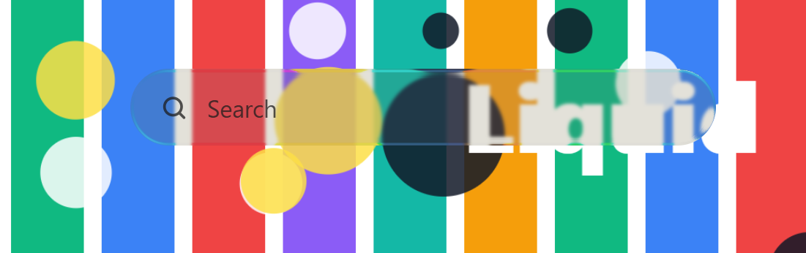
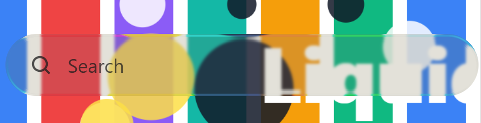

# liquid-glass-suite

[](LICENSE) [](https://admos98.github.io/liquid-glass-suite/) [](https://github.com/admos98/liquid-glass-suite/actions/workflows/pages.yml)



**Liquid Glass is refraction, not blur.** One suite with CSS/SVG and WebGL2 paths plus tools to measure the bend.

**[Open the live showcase →](https://admos98.github.io/liquid-glass-suite/)** — the standalone reference running on GitHub Pages. It also works offline from [`shared/assets/showcase.html`](shared/assets/showcase.html) with no server, build, or network.

> This skill suite was developed from publicly available information on the web and practical research with browser rendering engines. See [`NOTICE`](NOTICE). The showcase is self-contained and works offline.

One repository, one Claude Code plugin, four task-focused skills over shared assets. Start with the apply skill; open the interactive showcase for optics work.

## Skills

| Skill | Fires when | Use for |
|---|---|---|
| [`liquid-glass`](skills/liquid-glass/SKILL.md) | “make this glass”, glassmorphism, frosted/translucent UI, glass nav/card/modal | Drop-in and plain-CSS-first recipes for navigation, toolbar, tabs, cards, sheets, menus, buttons, search, sidebar and sliders |
| [`liquid-glass-optics`](skills/liquid-glass-optics/SKILL.md) | SVG graphs, reflective rim, WebGL2, Safari true-refraction strategy | Offline standalone showcase, original profile/map optics, renderer choice and behavior checks |
| [`liquid-glass-debug`](skills/liquid-glass-debug/SKILL.md) | Bend missing, Chrome works/iPhone fails, rim looks painted, glass looks plastic | S01–S33 symptom triage, Chromium/WebKit quirks, pixel measurements and verification gate |
| [`liquid-glass-native`](skills/liquid-glass-native/SKILL.md) | SwiftUI/UIKit/AppKit, `glassEffect`, native custom buttons | System-first APIs, DocC-checked declarations and older-OS/accessibility fallbacks |

## Install

Register the plugin marketplace and install the plugin:

```text
/plugin marketplace add admos98/liquid-glass-suite
/plugin install liquid-glass-suite@admos98-skills
```

The marketplace entry points at the repository root (`source: "./"`), and Claude Code auto-discovers all four folders under `skills/`. The full flow was owner-tested end-to-end with Claude Code 2.1.319: marketplace clone, install, four-skill discovery, strict manifest validation, all 17 package tests and the showcase build check pass. The listing icon is included, so strict validation reports no findings. See [`tests/evidence/verification.txt`](tests/evidence/verification.txt) for the test record, including the platform note.

**Manual install:** copy the entire `liquid-glass-suite` folder into the agent's skills area, then expose each `skills/<name>` folder in its skill scan path using the agent's supported folder-link mechanism. Each folder name matches its frontmatter `name`. Keep the suite intact because its `../../shared/...` references must resolve. For a local Claude Code run without marketplace installation, `claude --plugin-dir /path/to/liquid-glass-suite` loads the same unit.

## Shared core and two application paths

| Path | Purpose |
|---|---|
| [`shared/assets/liquid-glass.css`](shared/assets/liquid-glass.css) + `.js` | Default app path: tokens, themes, strategy-1 SVG lens, conservative capability gate and fallback |
| [`shared/assets/webgl-glass.js`](shared/assets/webgl-glass.js) | Explicit-texture WebGL2 path using the original showcase maps and historical dim behavior |
| [`shared/assets/showcase.html`](shared/assets/showcase.html) | Self-contained original showcase; no server, build, network or external assets needed to open it |
| [`shared/assets/showcase/`](shared/assets/showcase/) | Editable original optics, controller, template, seven presets and eight restored plates |
| [`shared/references/`](shared/references/) | Sixteen implementation, browser, measurement and honesty references |
| [`shared/scripts/`](shared/scripts/) | Displacement-map, edge-profile and chroma-retention measurement tools |

There are exactly two application paths: the shared CSS/JS drop-in by default, or WebGL2 through optics for explicit textures/Safari true-refraction briefs. The standalone showcase is a product demonstration, not a third application architecture. It intentionally restores the original 2× maps, profile/specular construction, presets, and historical linear dim; production wash guidance remains documented separately.

## Showcase



Open the [standalone showcase](shared/assets/showcase.html) directly from disk. No server, build, network, or external assets are required.

## Verify

```sh
npm ci
python -m pip install Pillow
node scripts/build-showcase.mjs --check
python -m unittest discover -s tests -v
node --check shared/assets/liquid-glass.js
node --check shared/assets/webgl-glass.js
node --check shared/assets/showcase/optics.js
node --check shared/assets/showcase/controller.js
npm test
```

The dev-only Chromium package supplies the Linux test runtime; on another platform use `PLAYWRIGHT_SYSTEM_CHROMIUM=1` after `npx playwright install chromium`. The marketplace install and strict manifest validation were owner-tested with Claude Code 2.1.319 — see [`tests/evidence/verification.txt`](tests/evidence/verification.txt) for actual runs. [`evals/`](evals/) contains ten agent benchmarks with empty results tables.

## Scope and license

- Apple publishes no numeric Liquid Glass specification. Keep `src: apple-hig | community | figma | measured` distinctions; browser heuristics are not Apple requirements.
- CSS syntax support is not paint evidence. Name the renderer, browser, geometry and fallback in every optical claim. Playwright is not a real iPhone, and native samples are not a native-runtime pass.
- Safari: the bend is confirmed working on the owner-tested iPhone Safari (standalone showcase opened in mobile Safari; iOS/Safari versions not recorded). Untested versions keep the frosted fallback as the guaranteed floor — verify on the target version.
- [`NOTICE`](NOTICE) contains the neutral development notice. [`tests/SHOWCASE_CONTRACT.md`](tests/SHOWCASE_CONTRACT.md) records behavior verification or explicit untested items.
- Project licensing is in [`LICENSE`](LICENSE). No external comparison baseline is bundled.
- Apple, Liquid Glass, SwiftUI and SF Symbols are trademarks of Apple Inc.; this project is not affiliated with or endorsed by Apple.
